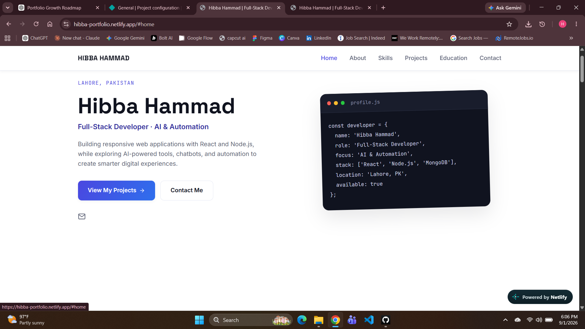
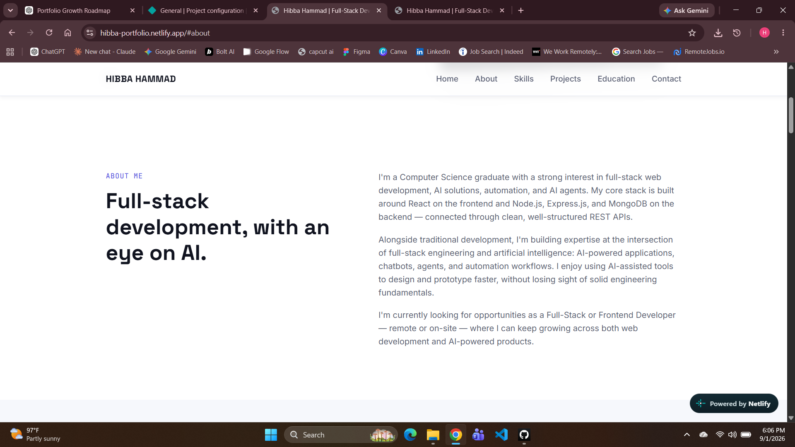
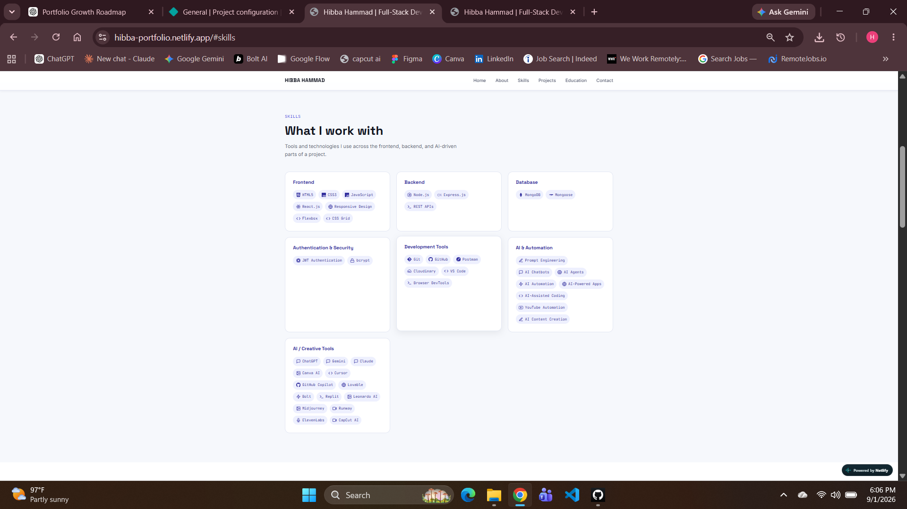
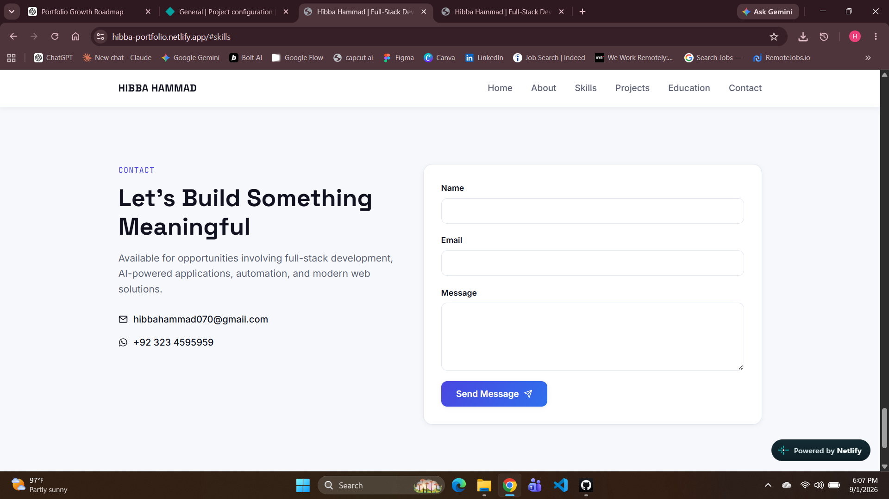

# 👋 Hi, I'm Hibba Hammad

### Full-Stack Developer | MERN Stack Developer

I’m a Computer Science graduate focused on building modern, responsive, and user-friendly web experiences.

I enjoy turning ideas into clean and functional web experiences while continuing to grow my skills across React, JavaScript, Node.js, Express, MongoDB, and full-stack development.

---

## 📌 About the Project

This repository contains my personal developer portfolio, created to showcase my skills, projects, and development journey.

## ✨ Highlights

* 📱 Responsive design
* 🎨 Modern and clean user interface
* 👩‍💻 About Me section
* 🛠️ Skills and technologies section
* 🚀 Projects showcase
* 📩 Contact section
* 🔗 Professional social links

## 🛠️ Tech Stack

* **HTML5**
* **CSS3**
* **JavaScript**
* **React**
* **Vite**
* **Git & GitHub**

## 📸 Screenshots

### 🏠 Home



### 👩‍💻 About



### 🛠️ Skills



### 📩 Contact



## 🚀 Live Demo

🌐 **[Visit My Live Portfolio](https://hibba-portfolio.netlify.app/)**

## 💻 Run Locally

### 1. Clone the repository

```bash
git clone https://github.com/hibbahammad/hibba-portfolio.git
```

### 2. Navigate to the project

```bash
cd hibba-portfolio
```

### 3. Install dependencies

```bash
npm install
```

### 4. Start the development server

```bash
npm run dev
```

Open the local URL provided by Vite.

## 🎯 Project Goals

* Build a professional developer portfolio
* Practice React and modern frontend development
* Create responsive user interfaces
* Showcase practical development projects
* Build practical experience with full-stack development

## 🔮 Future Improvements

* Add more full-stack projects
* Improve accessibility
* Add detailed project case studies
* Continue improving responsive design
* Expand the portfolio with new technologies

## 🤝 Connect With Me

📧 **Email:** [hibbahammad070@gmail.com](mailto:hibbahammad070@gmail.com)

💼 **LinkedIn:**
https://www.linkedin.com/in/hibba-hammad-0b4b643a2/

🐙 **GitHub:**
https://github.com/hibbahammad

🌐 **Portfolio:**
https://hibba-portfolio.netlify.app/

---

⭐ **Thanks for visiting my portfolio repository!**
